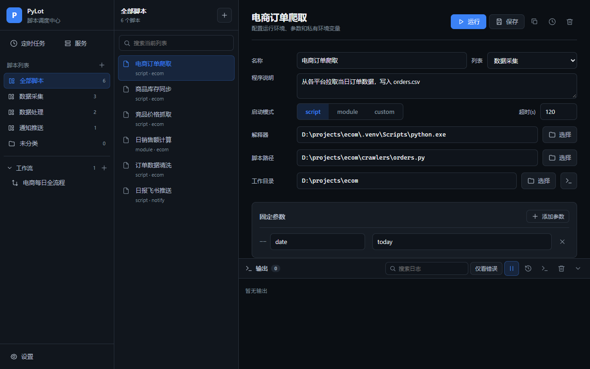
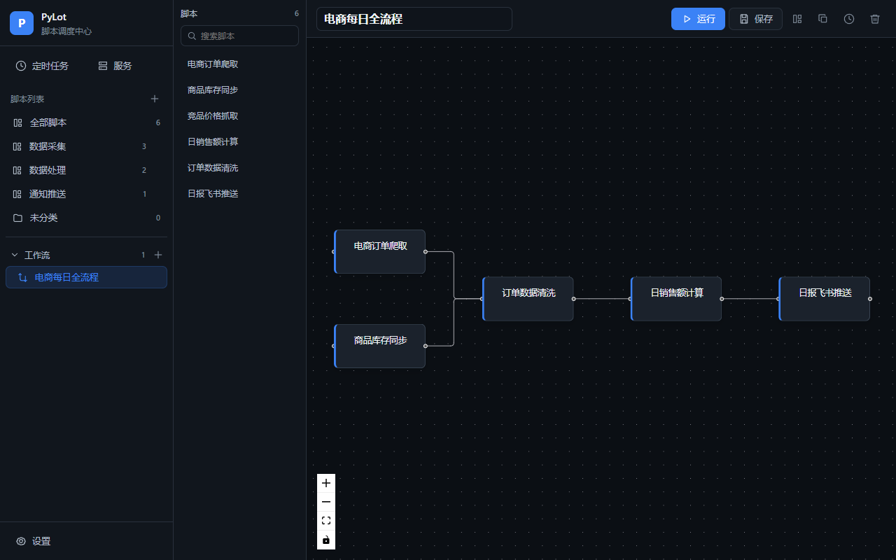
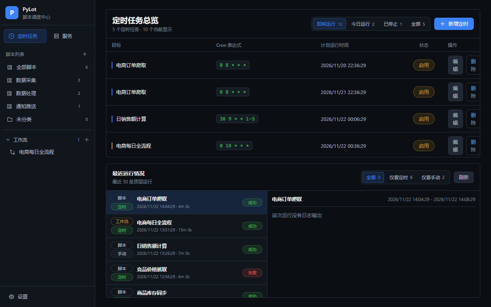
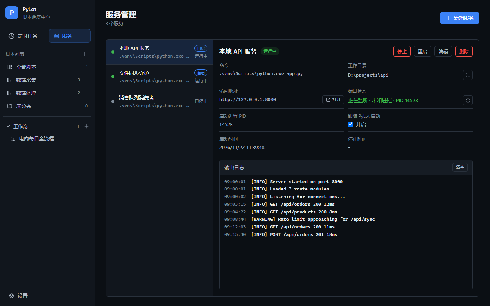

# PyLot

**PyLot** 是一个 Windows 桌面端的 Python 脚本调度管理工具。它把分散的 Python 脚本、运行参数、环境变量、定时策略、工作流依赖、长期服务和历史日志统一收进一个本地应用，消除手动开终端、拼命令、跑完忘记看日志的重复工作。

> 基于 [Wails](https://wails.io) + Go + Vue 3 构建，仅支持 Windows。

---

## 功能概览

| 模块 | 功能 |
|------|------|
| **脚本** | 注册 Python 脚本，配置解释器、参数、环境变量，手动运行，查看实时日志和历史记录 |
| **工作流** | 把多个脚本连成有向无环图（DAG），拓扑排序执行，同层并发，失败即止 |
| **定时任务** | 用 cron 表达式调度任意脚本或工作流，统一视图管理所有调度规则 |
| **服务** | 托管需要长期运行的本地进程（server、监听器、守护进程），开机自启，查看实时日志 |
| **系统托盘** | 关闭主窗口后调度保持运行，托盘图标反映脚本执行状态 |
| **通知** | 可选接入飞书 lark-cli，脚本或工作流执行结束后推送结果 |

---

## 截图

> 以下为各主要界面。

**脚本管理**



**工作流编辑器**



**定时任务**



**服务管理**



---

## 安装

前往 [Releases](../../releases) 页面下载最新版本的 `PyLot-windows-amd64.exe`，双击运行即可，无需安装，无需配置运行环境。

数据库文件（`script-manager.db`）会创建在与 exe 相同的目录下。**建议将 exe 放在一个固定的文件夹里，而不是桌面或下载目录。**

---

## 快速上手

1. 启动 PyLot，进入 **设置** 页，按需配置主题、字体和全局 `.env` 路径。
2. 在左侧脚本列表里点击 **+** 新建一个列表（如"数据处理"）。
3. 在列表中新增脚本，选择 `.py` 文件路径——PyLot 会自动推断虚拟环境解释器（向上查找 `.venv` 目录）和工作目录。
4. 确认配置后点击 **运行**，在底部日志面板查看输出。
5. 如果需要定时执行，点击脚本名右侧的时钟图标，添加 cron 规则。
6. 多个脚本有先后依赖时，进入 **工作流** 页编排。
7. 长期运行的本地进程（如本地 API）进入 **服务** 页托管。

关闭主窗口后应用会最小化到系统托盘，调度继续运行。在托盘图标右键选择 **退出程序** 才会真正退出。

---

## 功能说明

### 脚本

每个脚本记录包含：

- **解释器路径**：指向 `python.exe` 或虚拟环境中的 `python.exe`。
- **工作目录**：脚本运行时的 `cwd`。
- **启动模式**：`script`（直接运行 `.py` 文件）或 `module`（`python -m` 方式，自动转换模块名）。
- **固定参数 / 临时参数**：可在每次运行时临时覆盖。
- **超时**：若脚本超过指定秒数无任何输出，自动终止并标记 `timeout`。
- **私有 `.env`**：单脚本独有的环境变量，会覆盖全局同名变量。
- **程序说明**：自由文本字段，记录用途、来源和注意事项。

脚本列表支持自定义分组，分组可重命名、排序和删除（删除不会影响脚本）。

**运行历史**保存在 SQLite 中，默认保留最近 7 天，每次运行的完整日志随记录一起存储。

---

### 工作流

工作流使用可视化画布编辑有向无环图（DAG）：

- 从脚本列表拖拽节点到画布，用连线表达先后依赖。
- 执行时按拓扑排序分层：同层节点并发运行，依赖层等待前层全部完成。
- 任意节点失败，后续未执行的节点标记为"未执行"并中止。
- 双击节点可跳转到对应脚本配置。
- 工作流可复制、可单独配置定时任务。

历史运行视图展示每次执行的节点状态、耗时、各节点日志，失败时自动定位到第一个失败节点。

---

### 定时任务

定时任务页合并展示所有脚本和工作流的调度规则。

支持快捷配置（每日一次、每天多时刻、每周、工作日、循环间隔）和自定义 cron。自定义 cron 支持一次粘贴多行表达式，每行保存为独立规则。

**常用 cron 示例**

| 表达式 | 触发时间 |
|--------|---------|
| `0 9 * * 1-5` | 工作日每天 09:00 |
| `0 * * * *` | 每小时整点 |
| `*/15 * * * *` | 每 15 分钟 |
| `0 8,12,18 * * *` | 每天 08:00、12:00、18:00 |
| `30 18 * * 5` | 每周五 18:30 |
| `0 2 * * *` | 每天 02:00（夜间批处理） |

历史运行部分展示最近 50 条顶层运行记录，支持按触发来源（手动 / 定时）筛选。

---

### 服务

服务用于托管需要**持续运行**的本地进程：

- 填写名称、启动命令（支持相对路径和命令行参数）和工作目录。
- 可选配置端口号（http / https），PyLot 会监测端口状态并在端口冲突时提示。
- 开启 **跟随 PyLot 启动** 后，PyLot 启动完成即自动拉起该服务。
- 实时查看 stdout / stderr 日志，重启服务时会等待端口释放后再启动。

服务状态：`starting` → `running` → `stopping` → `stopped / exited / failed`

> 一次性任务请使用脚本或工作流，服务仅适合需要持续运行的进程。

---

### 环境变量

PyLot 支持两级环境变量：

- **全局 `.env`**：在设置页指定 `.env` 文件路径，所有脚本运行时都会注入。
- **脚本私有 `.env`**：在脚本配置中以 JSON 格式填写，只对该脚本生效，同名变量优先级高于全局。

运行时，PyLot 会将系统环境变量、全局 `.env` 和私有 `.env` 三者合并后传入子进程，并自动注入 `PYTHONIOENCODING=utf-8` 避免中文乱码。

---

### 通知（可选）

PyLot 支持通过 [lark-cli](https://github.com/chyroc/lark_cli) 在脚本或工作流执行结束后发送飞书消息。在设置页填写 lark-cli 路径和接收人 OpenID 即可启用。不配置时此功能静默跳过。

---

## 数据与存储

| 内容 | 位置 |
|------|------|
| 脚本配置、运行历史、日志 | exe 同目录的 `script-manager.db`（SQLite） |
| 全局 `.env` 路径、通知配置 | 同上，存入数据库 |
| 窗口大小、主题、字体 | 浏览器 `localStorage`（Wails WebView2） |
| 服务日志缓冲 | 内存，PyLot 退出后清空 |

历史运行日志默认保留 **7 天**，启动时自动清理过期记录。

---

## 从源码构建

**依赖**

- Go 1.21+
- Node.js 18+
- [Wails CLI v2](https://wails.io/docs/gettingstarted/installation)：`go install github.com/wailsapp/wails/v2/cmd/wails@latest`

**构建**

```bash
wails build
```

产物在 `build/bin/` 目录下。

**开发模式**（热重载）

```bash
wails dev
```

---

## 技术栈

| 层 | 技术 |
|----|------|
| 桌面框架 | [Wails v2](https://wails.io)（Go + WebView2） |
| 后端 | Go，SQLite（[modernc.org/sqlite](https://pkg.go.dev/modernc.org/sqlite)，纯 Go，无 CGo） |
| 前端 | Vue 3 + Vite + Pinia |
| 定时调度 | [robfig/cron v3](https://github.com/robfig/cron) |
| 系统托盘 | [getlantern/systray](https://github.com/getlantern/systray) |

---

## 注意事项

- **仅支持 Windows**。进程树终止（`taskkill /F /T`）、端口检测（`GetExtendedTcpTable`）和进程快照（`CreateToolhelp32Snapshot`）均使用 Windows API。
- PyLot 以**单实例**运行，重复启动时会激活已有窗口。
- 退出应用时，PyLot 会并发终止所有运行中的脚本和服务，最多等待 5 秒，超时后强制退出。进程终止不会弹出控制台窗口。
- 请勿直接删除或移动 `script-manager.db`，所有脚本配置均存储于此。

---

## License

MIT
